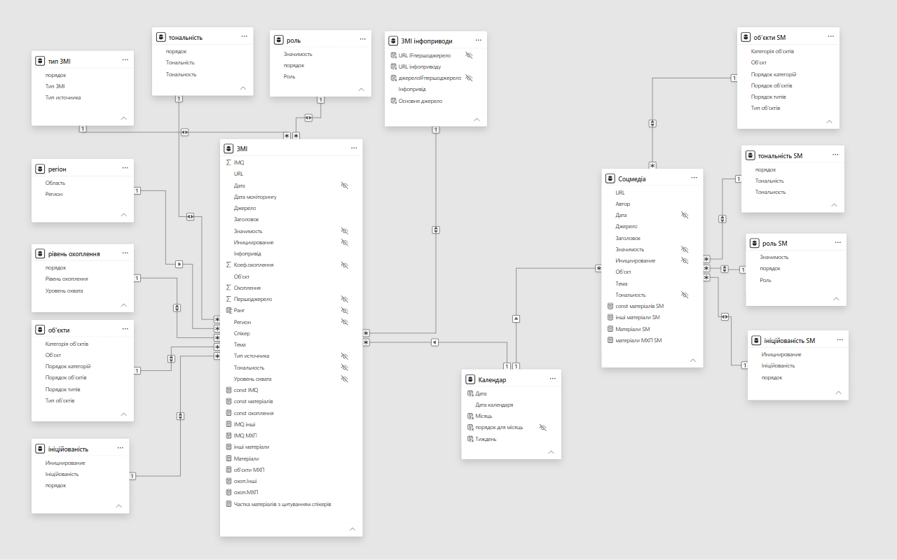
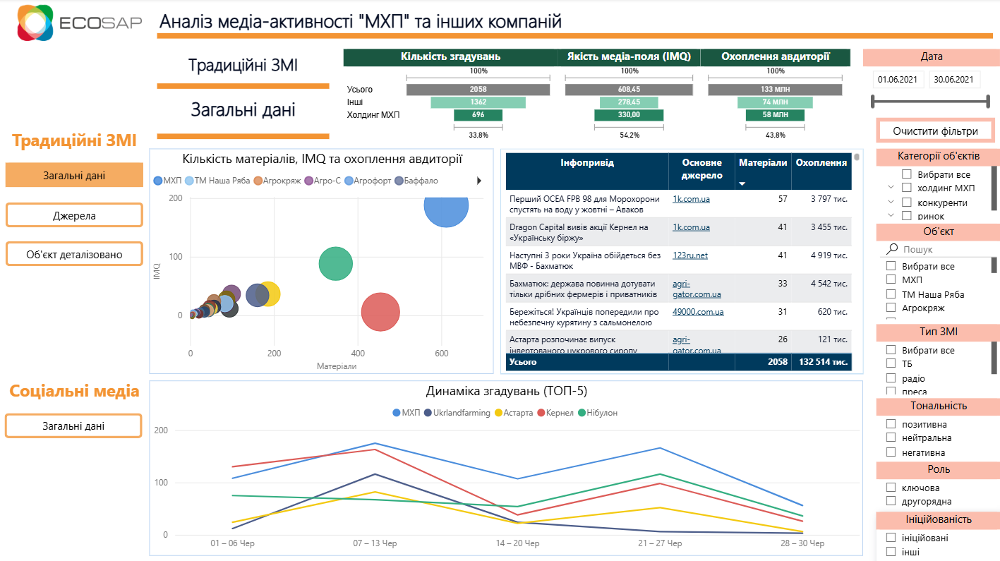
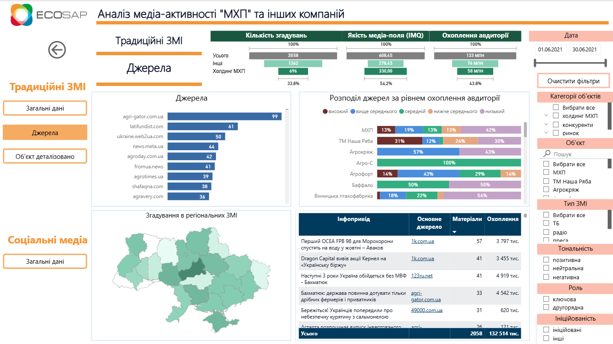
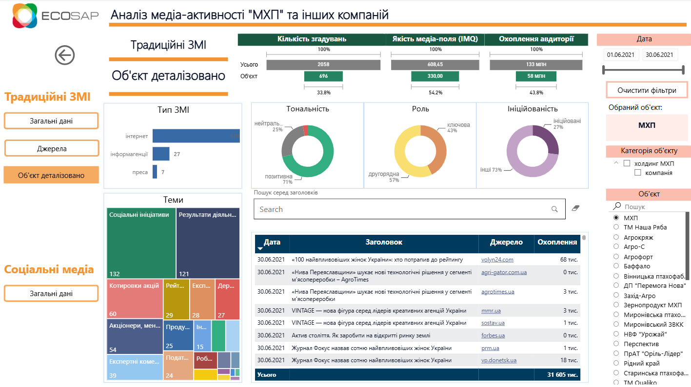
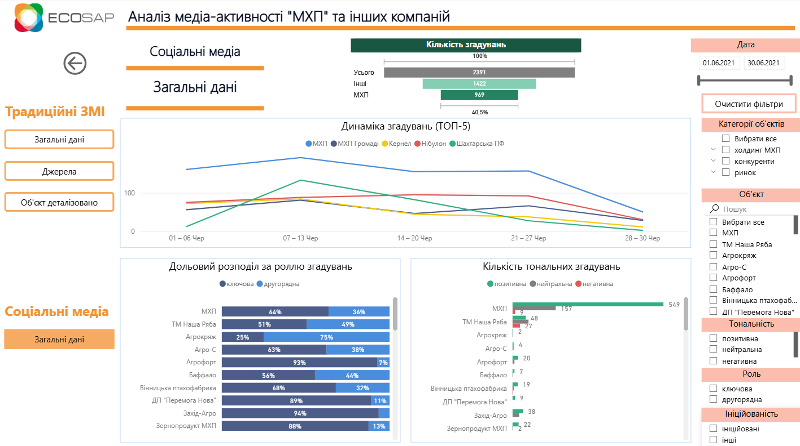

# Аналіз медіаактивності холдингу МХП та конкурентного середовища (Power BI)

> 🔗 **[Переглянути інтерактивний Power BI звіт (Live Demo)](https://app.powerbi.com/view?r=eyJrIjoiMDVmOWVhNzAtOTAxZi00YjJiLWJmMzYtZWUyMjFlMGEwYjc2IiwidCI6ImUxM2M3YmNjLWYwMzgtNDgwZS1hMTQzLTkxZWM1MTUyYmQ1ZSJ9)**

## Про проєкт

Інтерактивний аналітичний звіт розроблено під час роботи в консалтинговій агенції **ECOSAP** для комплексної оцінки медіаприсутності холдингу **МХП**, ефективності PR–активностей та моніторингу конкурентного середовища на ринку.

У робочому середовищі цей продукт функціонував як щоденно оновлюваний корпоративний звіт для групи компаній: кожен підрозділ чи окреме підприємство холдингу мало змогу аналізувати показники за своїм напрямом, тоді як керівництво бачило консолідовану картину по всій групі компаній та ринку загалом. Для публічного портфоліо представлено демонстраційну версію звіту на прикладі репрезентативного періоду – червня 2021 року.

## Бізнес–завдання

* **Консолідація каналів комунікації:** об’єднати дані з традиційних ЗМІ та соціальних медіа в єдину систему звітності для цілісної оцінки інформаційного поля.
* **Конкурентний аналіз:** забезпечити порівняння показників медіаприсутності холдингу МХП із ключовими гравцями ринку, а також можливість швидкого перегляду новин галузі.
* **Оцифрування медіаполя:** перетворити масив текстових згадувань на вимірювані бізнес–метрики якості присутності об’єктів дослідження в інфопросторі.

## Методологія та ключові показники (KPI)

Джерелом даних є масив публічних повідомлень із відкритих джерел: українських інтернет–ЗМІ, інформаційних агенцій, преси, телебачення, радіо, а також соціальних мереж, блогів, форуми і відеоплатформ. Одиницею аналізу виступає публікація зі згадуванням об’єкта дослідження.

У звіті використовуються такі медіаметрики:

* **Кількість згадувань** – загальна кількість публікацій, у яких фігурує компанія або бренд, а також частка компанії в загальному потоці новин ринку.
* **Охоплення авдиторії** – потенційна кількість контактів авдиторії з публікаціями про компанію.
* **IMQ** – інтегральний показник якості медіарезонансу, що характеризує рівень представленості об’єкта у ЗМІ з урахуванням тональності та ймовірності донесення меседжу до авдиторії.
* **Роль** – визначає, чи є об’єкт головним героєм або ініціатором повідомлення (*ключова роль*), чи згадується побіжно (*другорядна роль*).
* **Тональність** – параметр, що залежить від фактичної або оціночної характеристики об’єкта в публікації та потенційних наслідків згадування. Приймає одне з трьох значень: *позитивна*, *негативна* або *нейтральна*.
* **Ініційованість** – розподіл публікацій на ініційовані компанією матеріали та органічні згадування.

## Модель даних та підготовка у Power Query

Модель даних побудована навколо двох незалежних таблиць фактів (`ЗМІ` та `Соцмедіа`), які об’єднані через спільний довідник `Календар` та пов’язані з тематичними довідниками (об’єкти моніторингу, типи ЗМІ, регіони, рівень охоплення, тональність, роль, ініційованість та зведена таблиця інфоприводів). Така структура дозволяє коректно фільтрувати дані за датами та категоріями без конфліктів між різними каналами медіа.

На етапі підготовки даних у **Power Query** виконано фільтрацію рядків і значень, зміну типів даних, об’єднання таблиць, очищення довідників від категорій, що не використовуються у звіті, а також обмеження вибірки періодом в 1 місяць для оптимізації демонстраційного звіту.



## Ключові розрахунки та логіка формул у DAX

У проєкті реалізовано низку розрахункових стовпців та мір для гнучкої роботи з контекстом фільтрів:

### 1. Розрахунок загальноринкових показників для оцінки частки бренду
Щоб користувач міг порівнювати конкретний бренд із загальним обсягом ринку, створено міри, які ігнорують вибір окремого об’єкта у зрізі, але продовжують реагувати на вибраний період, тип ЗМІ чи тональність:

```dax
const матеріалів = CALCULATE([Матеріали], REMOVEFILTERS('об''єкти'))

об'єкти МХП = CALCULATE(DISTINCTCOUNT('ЗМІ'[URL]), REMOVEFILTERS('об''єкти'), 'об''єкти'[Категорія об'єктів] = "холдинг МХП")
```

### 2. Ранжування публікацій усередині одного інфоприводу
Оскільки одна новина може тиражуватися десятками видань, для кожного інформаційного приводу розраховується ранг публікацій за рівнем охоплення авдиторії:

```dax
Ранг = 
VAR curTitle = 'ЗМІ'[Заголовок]
RETURN
RANKX(
    FILTER(ALL('ЗМІ'), 'ЗМІ'[Заголовок] = curTitle),
    'ЗМІ'[Охоплення],,DESC,Dense
)
```

### 3. Автоматичне визначення основного джерела новини
На основі розрахованого вище рангу наступна формула визначає першоджерело інфоприводу: спочатку перевіряє наявність прямої позначки першоджерела (`Першоджерело = 1`), а якщо такої мітки немає – автоматично підтягує видання з найвищим охопленням (`Ранг = 1`) у межах цього інфоприводу:

```dax
Основне джерело =
IF (
    'ЗМІ інфоприводи'[джерелоIFпершоджерело] = BLANK (),
    CALCULATE (
        FIRSTNONBLANK ( 'ЗМІ'[Джерело], 1 ),
        FILTER (
            ALL ( 'ЗМІ' ),
            'ЗМІ'[Інфопривід] = 'ЗМІ інфоприводи'[Інфопривід] && 'ЗМІ'[Ранг] = 1
        )
    ),
    'ЗМІ інфоприводи'[джерелоIFпершоджерело]
)
```

### 4. Групування тижнів у межах календарного місяця
Для побудови графіків динаміки по тижнях створено формулу, яка обрізає межі першого та останнього тижня місяця, щоб дати не переходили на сусідні місяці:

```dax
Тиждень =
VAR StartOfWeekRaw =
    'Календар'[Дата календаря] - WEEKDAY ( 'Календар'[Дата календаря], 2 ) + 1
VAR EndOfWeekRaw = StartOfWeekRaw + 6
VAR FirstOfMonth =
    DATE ( YEAR ( 'Календар'[Дата календаря] ), MONTH ( 'Календар'[Дата календаря] ), 1 )
VAR LastOfMonth =
    EOMONTH ( 'Календар'[Дата календаря], 0 )
VAR StartOfWeek =
    IF ( StartOfWeekRaw < FirstOfMonth, FirstOfMonth, StartOfWeekRaw )
VAR EndOfWeek =
    IF ( endOfWeekRaw > LastOfMonth, LastOfMonth, EndOfWeekRaw )
RETURN
    FORMAT ( StartOfWeek, "[$-uk-UA]dd" ) & " – "
        & FORMAT ( EndOfWeek, "[$-uk-UA]dd MMM" )
```

## Структура та візуалізація звіту

Звіт складається з чотирьох основних аналітичних сторінок з єдиною панеллю навігації, синхронізованими зрізами та кнопкою скидання фільтрів через закладки:

### 1. Загальні дані (Традиційні ЗМІ)
Верхній KPI–банер із часткою холдингу МХП на ринку (згадування, IMQ, охоплення), бульбашкова діаграма співвідношення кількості матеріалів та якості медіаполя за компаніями, рейтинг інфоприводів із посиланнями на основні джерела та динаміка згадувань ТОП–5 компаній.



### 2. Джерела
Структура публікацій за типами медіа (інтернет–ЗМІ, інформагенції, преса, ТБ, радіо), рейтинг провідних видань, розподіл джерел за рівнем охоплення та географічний розподіл згадувань у регіональних ЗМІ на карті.



### 3. Об’єкт деталізовано
Поглиблений розріз за окремими підприємствами та брендами холдингу, аналіз типів ЗМІ, тональності, ролі об’єкта в публікаціях, ключових тем та перелік заголовків із пошуком.



### 4. Загальні дані (Соціальні медіа)
Зріз моніторингу за соцмережами: частка холдингу в загальному потоці згадувань, тижнева динаміка присутності ТОП–5 гравців ринку, розподіл згадувань за роллю та тональністю.



–––

*Вихідний файл проєкту у форматі `.pbix` доступний у цьому репозиторії для локального ознайомлення з моделлю даних та налаштуванняvb візуалізацій.*